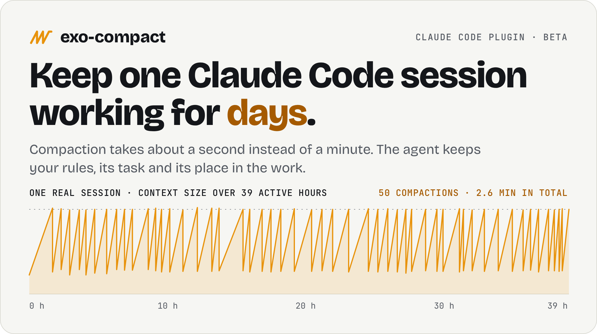
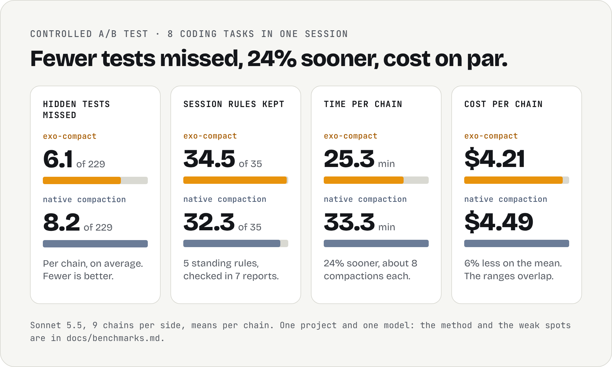

<p align="center">
  <picture>
    <source media="(prefers-color-scheme: dark)" srcset="docs/assets/hero-dark.png">
    
  </picture>
</p>

<p align="center">
  
  
  
  
</p>

<p align="center">
  <a href="#install">Install</a> ·
  <a href="#how-it-compares">Comparison</a> ·
  <a href="#how-it-works">How it works</a> ·
  <a href="#results">Results</a> ·
  <a href="#cost-and-privacy">Cost and privacy</a> ·
  <a href="#faq">FAQ</a>
</p>

<table align="center">
  <tr>
    <td align="center" width="290">
      <h3>0.4 s</h3>
      per compaction, at the median<br>
      <sub>native compaction: 62 s</sub>
    </td>
    <td align="center" width="290">
      <h3>50 in a row</h3>
      compactions in one session<br>
      <sub>39 hours of active work, 4,891 tool calls</sub>
    </td>
    <td align="center" width="290">
      <h3>34.5 / 35</h3>
      session rules kept per chain in the A/B test<br>
      <sub>native compaction: 32.3 / 35</sub>
    </td>
  </tr>
</table>

## Install

Two commands inside Claude Code. You need Claude Code 2.1.278 or newer and Node.js 22.15 or newer.

```
/plugin marketplace add MarcinSufa/exo-compact
/plugin install exo-compact@exo-compact
```

The marketplace also lists `exovault-s4-trigger`, an optional, experimental soft-trigger companion;
the install above installs only `exo-compact`.

Restart Claude Code, and the next time the context fills, exo-compact handles it. Installed means
enabled, in every project, with session search on. There is nothing to build, no `npm install` and
no flag to set. `claude -p` and SDK runs stay on native compaction. If your Node.js or Claude Code
is too old, the session says so in one line and leaves compaction to Claude Code.

**No API key is needed.** One extra is optional and off by default: the Jev rule check, which
checks each reply against your rules through TypeSafe's Jev API and needs a TypeSafe API key.
See [Do I need a Jev API key?](#faq)

**To update**, run these inside Claude Code, then restart it:

```
/plugin marketplace update exo-compact
/plugin update exo-compact@exo-compact
```

Installing and updating this way both follow `main`, so you get each change as soon as it is merged. **To stay on released versions**,
use the installer script below instead: it installs the tag of the latest release.

<details>
<summary><b>Installer script (latest release), Windows, one project only, opting out</b></summary>

<br>

**The installer script** is the alternative. It installs the tag of the latest release rather than `main`, and
keeps a clone in `~/.exo-compact`, which the launcher, `tools/status.mjs` and `setup.cjs` use. Run the same command
again to update to a newer release.

```bash
curl -fsSL https://raw.githubusercontent.com/MarcinSufa/exo-compact/main/install.sh | bash
```

**On Windows**, in PowerShell (not tested on a real Windows machine yet):

```powershell
irm https://raw.githubusercontent.com/MarcinSufa/exo-compact/main/install.ps1 | iex
```

**To keep it out of one project**, put an opt-out file in that project
(`node <plugin>/setup.cjs optout <dir>` does the same):

```bash
mkdir -p .exovault && touch .exovault/s4-compact-off
```

```powershell
New-Item -ItemType File -Force .exovault/s4-compact-off | Out-Null
```

**To use it in one project only**, turn it off in your home directory and on in the project.
`setup.cjs disable ~` and `setup.cjs enable <dir>` do the same:

```bash
mkdir -p ~/.exovault && touch ~/.exovault/s4-compact-off                 # off everywhere
cd ~/work/my-project && mkdir -p .exovault && touch .exovault/s4-compact-active   # on here
```

```powershell
New-Item -ItemType File -Force "$HOME/.exovault/s4-compact-off" | Out-Null      # off everywhere
cd ~/work/my-project; New-Item -ItemType File -Force .exovault/s4-compact-active | Out-Null   # on here
```

[docs/install.md](docs/install.md) covers the manual install, the launcher that needs no install,
scripted runs and uninstalling.

</details>

## See it in a real session

<p align="center">
  
  <br>
  <sub>A real recorded session, sped up. The auto-compact window was set small for the recording (the compaction came at 67k tokens), so the context fills in about a minute.</sub>
</p>

After the first compaction in your own session, ask for the status. This is the output from a
real session:

```console
$ node ~/.exo-compact/tools/status.mjs
baf7de50  S4     ~/work/my-project  active 10-07 14:57 -> 10-12 19:24
          compact 10-07 15:22 s4      auto  218k -> 4k  1.2s
          compact 10-07 15:46 s4      auto  219k -> 12k  1.7s
          compact 10-07 16:08 s4      auto  217k -> 5k  1.9s
          compact 10-07 17:30 s4      auto  218k -> 4k  0.4s
```

Each line is one compaction: when it happened, that exo-compact did it (`s4`), the tokens before
and after, and how long it took.

## How it compares

A long Claude Code session fills its context window again and again. Each time, native
compaction stops the work for about a minute while the model rewrites the conversation as a
summary. After enough rounds the agent is working from a summary of a summary, and you start a
fresh session to get it back on track.

exo-compact replaces that step. It records the session while it runs, and when the window fills
it rebuilds the context from those records, with no model call.

<p align="center">
  <picture>
    <source media="(prefers-color-scheme: dark)" srcset="docs/assets/compare-dark.png">
    
  </picture>
</p>

<details>
<summary><b>The full comparison as a table</b></summary>

<br>

| | Native compaction | exo-compact |
|---|---|---|
| **How the new context is made** | the model summarizes the conversation | rebuilt from records kept during the session, with no model call |
| **Time per compaction** | about a minute | about a second |
| **Your rules and rules files** | rewritten in the summary | quoted word for word |
| **The current task** | whatever the summary says | a task card the model keeps current, plus your latest long request in full |
| **Details from before** | gone unless the summary kept them | searchable on your machine with `search_session` |
| **If something goes wrong** | n/a | the session falls back to native compaction |
| **Cost** | baseline | on par in the A/B test at an equal window: 6% less on the mean, with overlapping ranges |

</details>

### What you get

- ⚡ **No more one-minute pauses.** A compaction takes 0.4 s at the median, against 62 s for
  native compaction.
- 📌 **Your rules are quoted, not paraphrased.** Standing instructions and rules files go into
  the new context word for word.
- 🧭 **The agent knows what it was doing.** A task card with the goal, the rules, what is done and
  the next step is kept current in the background, and your latest long request is saved in full.
- 🔎 **Nothing is lost for good.** Everything from before the compaction stays searchable on your
  machine. The agent looks details up by itself, at about 900 tokens per lookup.
- 🔒 **Local.** No account, no service and no API key. The records and the search index stay on
  your machine. The one optional extra, the Jev rule check, needs a TypeSafe API key.
- 🛟 **Safe to try.** Two commands install it, and any project can opt out. If anything
  goes wrong, the session falls back to native compaction.

## How it works

<p align="center">
  <picture>
    <source media="(prefers-color-scheme: dark)" srcset="docs/assets/how-it-works-dark.png">
    
  </picture>
</p>

Native compaction hands the agent a summary written by the model. exo-compact hands it a
structured context that is built the same way every time:

```
## Constraints        your standing rules and adopted rules files, quoted verbatim
## Task card          goal, rules, done, next step: kept current by the session's own model
## Task brief         your newest long request, verbatim, plus a checklist
## Work state         cwd, branch, uncommitted files, worktrees, tasks, background jobs
## Session map        one line per earlier stretch of the session: asks, files edited, commits
## Working notes      exact values, ids and command output lines from before the compaction
## File pointers      the files that were read and edited, so the agent can re-open them
... followed by the most recent messages, verbatim
```

Whatever does not fit is not thrown away. The agent has a `search_session` tool that searches
the whole earlier session on your machine and returns short excerpts, so it can find an old
decision or an exact value without loading the history back into its context.

[docs/how-it-works.md](docs/how-it-works.md) explains each step.

## Results

### Controlled A/B test

One long session works through a chain of 8 real coding tasks, with about 8 compactions per
chain. Nine chains per side, Sonnet 5.5, 229 hidden tests per chain that the agent never sees, and
5 standing session rules checked in 7 reports (35 checks per chain). exo-compact ran with the
4.8.0 defaults, so no API key and no rule check. The chains ran in pairs, one per side at the same
time and at the same 100k-token auto-compact window; only the
first two exo-compact chains were compared with native chains run the day before.

<p align="center">
  <picture>
    <source media="(prefers-color-scheme: dark)" srcset="docs/assets/results-ab-dark.png">
    
  </picture>
</p>

exo-compact missed fewer hidden tests (6.1 against 8.2 per chain), kept more session rules (34.5
against 32.3 of 35) and finished 24% sooner. On cost it is on par: 6% cheaper on the mean, but the
per-chain ranges overlap ($3.78 to $4.70 against $3.91 to $5.35) and the medians are close ($4.31
against $4.36), so read it as "the same or a little cheaper", not as a saving. An earlier A/B
measured about 40% more than native; that came from two nudges, brief push and brief check, which
are off by default since 4.8.0.

**A small window keeps a long session cheap.** Both sides compacted at the same context size, so
the test compares the compactions and nothing else. Over a long session the size of the context
matters more. Every model call reads the whole context again, mostly from the prompt cache, so
the bill follows the tokens carried per call. With native compaction, a larger window is the way
to compact less often: fewer one-minute pauses, fewer summaries. A compaction that takes 0.4
seconds and keeps the session searchable can run often, so the window can stay small.

| Long session | Context carried per call |
|---|---:|
| exo-compact, compacting at about 218k tokens (measured: 33,200 calls in 83 sessions) | **135k tokens** on average |
| Native compaction on a 1M window, left to fill (estimate, not measured) | about 500k tokens |

The second row is arithmetic, not a test result: a context that grows from a summary up to the
window limit sits at about half the window on average, in a session long enough to fill it. The
same rule gives 131k for the first row, against 135k measured. At an equal window native
compaction carries the same context as exo-compact, so the saving comes from the smaller window
alone. And a large window only postpones native compaction. When it comes, the session is still
replaced by a summary, and a detail the summary left out cannot be looked up again. Method and
limits: [docs/benchmarks.md](docs/benchmarks.md#context-carried-per-call).

<details>
<summary><b>All the numbers</b></summary>

<br>

Means per chain over 9 chains per side.

| | exo-compact | Native compaction |
|---|---:|---:|
| Hidden tests passed (of 229) | **222.9** | 220.8 |
| Hidden tests passed, all chains | **2,006 / 2,061** | 1,987 / 2,061 |
| Session rules kept (of 35) | **34.5** | 32.3 |
| Time per chain | **25.3 min** | 33.3 min |
| Compactions per chain | 7.7 | 7.8 |
| Work on the wrong task after a compaction | 0 | 0 |
| Cost per chain, mean | **$4.21** | $4.49 |
| Cost per chain, median | **$4.31** | $4.36 |
| Cost per chain, range | $3.78 to $4.70 | $3.91 to $5.35 |

</details>

### A/B at a 200k window (3 pairs)

With `interactiveOnly=false`, exo-compact was compared with native compaction on the same 8-task chain
at a 200k-token window. There were 3 pairs, each run at the same time, with 229 hidden tests and 35 rule
checks per chain.

| Mean per chain | exo-compact | Native compaction |
|---|---:|---:|
| Hidden tests passed (of 229) | 226.7 | 223.7 |
| Rules kept (of 35) | 35.0 | 33.3 |
| Time | 29.0 min (12% sooner) | 32.9 min |
| Cost | $4.42 (on par) | $4.46 |
| Compactions | 1.3 | 1.7 |

Only 3 pairs were run, so no difference here is statistically sure; four of native's five missed rule
checks came before the first compaction in pair 1, making the rule gap mostly noise. exo-compact cost
more in pair 1; see [per-pair results and setup](docs/benchmarks.md#ab-at-a-200k-window-2026-10-23).

### Two weeks of daily use

<p align="center">
  <picture>
    <source media="(prefers-color-scheme: dark)" srcset="docs/assets/daily-use-dark.png">
    
  </picture>
</p>

After 126 of the 255 compactions the agent searched the earlier session at least once. Over
these 255 compactions the shorter pauses add up to about four hours of waiting saved.

<details>
<summary><b>All the numbers</b></summary>

<br>

| | exo-compact | Native compaction |
|---|---:|---:|
| Sessions / compactions | 80 / 255 | 19 / 38 |
| Time per compaction (median) | **0.4 s** | 62 s |
| Time per compaction (90th percentile) | **3.8 s** | 90 s |
| Lookups of earlier details by the agent | 507 | n/a |

</details>

### Long sessions

The longest unbroken runs on exo-compact so far, counted from the maintainer's own sessions.
Active hours leave idle time out.

| Compactions in a row | Active hours | Calendar days | Tool calls | User messages |
|---:|---:|---:|---:|---:|
| 50 | 39.0 | 7.1 | 4,891 | 313 |
| 23 | 38.6 | 6.1 | 3,242 | 137 |
| 10 | 17.6 | 1.6 | 943 | 46 |
| 15 | 15.9 | 5.2 | 1,379 | 71 |
| 8 | 9.9 | 1.1 | 916 | 7 |

- **The first row is the chart at the top.** Its 50 compactions took 2.6 minutes in total. At
  the native median of 62 s each, they would have taken about 52 minutes.
- **The last row is a largely unattended session:** about 10 hours of work and 916 tool calls on
  7 user messages.

These numbers come from one person's projects. [docs/benchmarks.md](docs/benchmarks.md) has the
method, every measurement and the weak spots, including the ones that do not flatter the plugin.

## Cost and privacy

- **The compaction itself is free.** It makes no model call.
- **The task card has a running cost.** It is refreshed by a background fork of your
  session's own model. With the 4.8.0 defaults the whole plugin still cost about the same as native
  compaction in the A/B test (6% less on the mean). Turn the card off with `taskCard=false`.
- **A small window keeps a long session cheap.** Each call reads the whole context again. Measured
  over 83 sessions, exo-compact carried 135k tokens per call on average. A 1M window left to fill
  carries about 500k (an estimate, [explained above](#controlled-ab-test)).
- **Your data stays where it already was.** The capture store and the search index are files on
  your machine, with keys redacted, kept out of git, and deleted 30 days after a session's last use
  (`retentionDays`). The only model calls go to Anthropic, like the rest of your session.
- **One optional download.** Session search can use local vectors (about 280 MB from npm and
  Hugging Face on first use). They run on your CPU. Turn them off with `recallVectors=false`.
- **One optional outside service, off by default.** [Jev](https://typesafe.ai), a judgement
  model run by TypeSafe, can check each reply against your rules. It needs your own TypeSafe API
  key and sends text to TypeSafe only if you turn it on. TypeSafe bills those calls itself, so they
  are not in the cost figures on this page.

Details: [docs/privacy-and-cost.md](docs/privacy-and-cost.md). All options:
[docs/configuration.md](docs/configuration.md).

## FAQ

<details>
<summary><b>Does it change how I use Claude Code?</b></summary>

<br>

No. You work as before. What you notice is that a compaction is over in a moment and the agent
carries on with the same task.

</details>

<details>
<summary><b>What happens if it breaks?</b></summary>

<br>

The session falls back to native compaction. That also happens by design when a rebuilt context
cannot fit. You are never left without a compaction.

</details>

<details>
<summary><b>Can I still run <code>/compact</code> myself?</b></summary>

<br>

Yes. A manual `/compact` goes through exo-compact as well.

</details>

<details>
<summary><b>Can I use it in one project only?</b></summary>

<br>

Yes. Turn it off in your home directory and on in that project, as shown under
[Install](#install). Any other project can opt out with `.exovault/s4-compact-off`.

</details>

<details>
<summary><b>Does it work with subagents and scripted runs?</b></summary>

<br>

Subagents keep native compaction. Scripted (`-p`) runs use exo-compact when you start them
through the launcher. With the installed plugin they stay on native compaction.

</details>

<details>
<summary><b>Which models was it tested with?</b></summary>

<br>

Sonnet 5.5 in the A/B test, and mostly Opus 5.5 in daily use.

</details>

<details>
<summary><b>Do I need a Jev API key?</b></summary>

<br>

No. Compaction, the task card and session search work without one, and a default install never
calls Jev.

A key is needed for one optional feature, the rule check. At the end of a turn it asks
[Jev](https://typesafe.ai), a judgement model run by TypeSafe, which of your task's rules the
reply or the diff breaks, and shows them to the agent once before it stops. The A/B test above ran
with it off. To use it, set a TypeSafe API key as `TYPESAFE_API_KEY` in the shell that starts Claude
Code, then turn the option on:

```bash
claude plugin install exo-compact@exo-compact --config ruleCheck=true
node ~/.exo-compact/plugin/compact/setup.cjs doctor   # warns if the key is missing, rejected or out of credit
```

If the option is on and the key does not work, the session also says so once, in a notice line.
The VS Code and Cursor extension does not draw that line, so there run the `doctor` command above.

Experimental: `EXO_JEV_URL` points the plugin at a Jev-compatible server of your own instead of TypeSafe, with no key
for an address on your machine. On a CPU alone it was too slow for the rule check, and a model you run yourself will
not score like TypeSafe's Jev, which the rule check's thresholds were measured with:
[docs/install.md](docs/install.md#a-jev-server-of-your-own-exo_jev_url-experimental).

What it sends and how to keep it off for a project:
[docs/install.md](docs/install.md#optional-jev-rule-check).

</details>

<details>
<summary><b>Does it work on Windows?</b></summary>

<br>

It is built for Linux and macOS. There is a PowerShell installer and launcher for Windows, but
they have not been tested in real use yet.

</details>

<details>
<summary><b>How do I remove it?</b></summary>

<br>

`.exovault/s4-compact-off` in a project keeps it off there (`setup.cjs optout` writes it). `claude plugin
uninstall exo-compact@exo-compact` removes it. The full uninstall and what it
leaves behind are in [docs/install.md](docs/install.md#opt-out-and-uninstall).

</details>

## Status and limitations

exo-compact is in **beta**.

- **Young API.** It is a Claude Code mod, built on the mods API that became public in Claude Code
  2.1.287 (the plugin also loads without a flag on 2.1.278, the minimum). That API is new and has
  already changed between releases. If an update breaks the plugin, sessions fall back to native
  compaction. Tested on 2.1.292.
- **Narrow evidence.** The controlled A/B covers one project, one model and nine pairs at 100k, with 3
  more pairs at a 200k window; the daily-use numbers describe one person's sessions. Please report what
  you see on your own work.
- **Scripted runs stay on native compaction.** `claude -p` and SDK runs keep native compaction by default
  because `interactiveOnly` defaults to `true`. A benchmark of these runs must set
  `interactiveOnly=false`, or it measures native compaction on both sides. Install with
  `claude plugin install exo-compact@exo-compact --config interactiveOnly=false`;
  `node ~/.exo-compact/plugin/compact/setup.cjs doctor` shows the setting.
- **Cost on par, not lower.** 6% less than native compaction on the mean in the A/B test, at an
  equal window, but the per-chain cost ranges overlap and the medians are close.
- **Rules can still drop.** A session-wide rule can still be lost, as with native compaction
  (on average 0.5 of 35 rule checks failed per chain in the A/B test, against 2.7 for native).
- **Main sessions only.** Subagents keep native compaction.
- **`--strict-mcp-config` turns session search off.** Compactions still work, but the agent
  cannot search the earlier session.

## Documentation

- [Install and run](docs/install.md): plugin install, installer, launcher, checks, uninstall
- [How it works](docs/how-it-works.md): capture, the compaction, what happens after it
- [Configuration](docs/configuration.md): every option
- [Privacy and cost](docs/privacy-and-cost.md): what leaves the machine, what is stored, what it costs
- [Benchmarks](docs/benchmarks.md): methods and all measurements
- [Development](docs/development.md): tests, typecheck, repository layout
- [Changelog](CHANGELOG.md)

## Contributing

Issues and pull requests are welcome. For a compaction problem, please include the output of
`node ~/.exo-compact/plugin/compact/setup.cjs doctor --json` and the `tools/status.mjs` lines for
the session.

## License

[MIT](LICENSE) © 2026 Marcin Sufa
